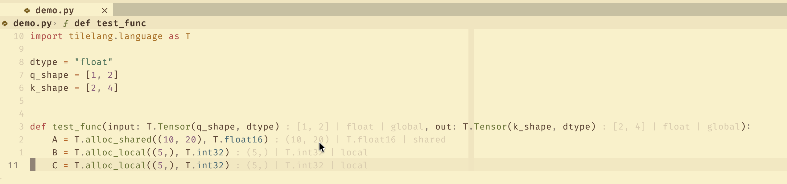

# TileLang LSP (tlsp)

A simple Language Server Protocol (LSP) implementation for TileLang, providing inlay hints for buffer shapes, data types, and memory scopes.

## Features

- **Inlay Hints**: Automatically displays information for `T.alloc_shared`, `T.alloc_local`, `T.alloc_fragment`, `T.match_buffer`, and `T.Tensor` calls.
    - Format: `: shape | dtype | scope`
    - Example: `: (128, 32) | T.float16 | shared`
- **Shape Evaluation**: Attempts to statically evaluate shape arguments, resolving variables and basic arithmetic within the function scope.
- **Dtype & Scope Detection**: Parses data types and memory scopes from arguments or infers them from function names.

## Installation

1. Ensure you have Python 3.8+ installed.
2. Install dependencies:
   ```bash
   pip install pygls
   ```

## Usage

### Running the Server

The server communicates via Stdio. You can run it directly:

```bash
python3 server.py
```

### NeoVim Configuration

To use the server with NeoVim, add the following to your lsp config. It would auto start the server and enable it for Python files.

```lua
vim.lsp.config['tlsp'] = {
cmd = { 'python', 'PATH/TO/tlsp/server.py' },
filetypes = { 'python' },
root_markers = {
  'pyproject.toml',
  'setup.py',
  'setup.cfg',
  'requirements.txt',
  'Pipfile',
  '.git',
},
}
vim.lsp.config['tlsp'].capabilities = vim.lsp.protocol.make_client_capabilities()
vim.lsp.enable("tlsp")
```

<! add a image ----> 
A demo of the server in action: 



### VS Code Configuration

A VS Code extension version of tilelang-LSP is provided. 

To package and release the extension, one can run
```bash
cd tilelang_lsp_extension
npm install
vsce package
```
If there are some confirmations that show up in the console, please type in "yes".
Once the extension is packaged, an extension program "tilelang-type-decorator-(*version).vsix" will appear in the current folder, and you can install this extension with VSCode.


If you are a developer and you wish to debug the extension, you can run

```bash
cd tilelang_lsp_extension
npm install
npm run compile
```
and in VS Code, open src/extension.ts and press F5 to enter the debug mode.

A successful installed extension will lead to the following screen display in VS Code


For more information, please check the README.md file in the folder /tilelang_lsp_extension

## How it works

The server uses Python's `ast` module to parse the code and traverse the syntax tree. It tracks variable assignments within functions to resolve shape variables used in buffer allocations. It also inspects function arguments to extract data type and scope information.
