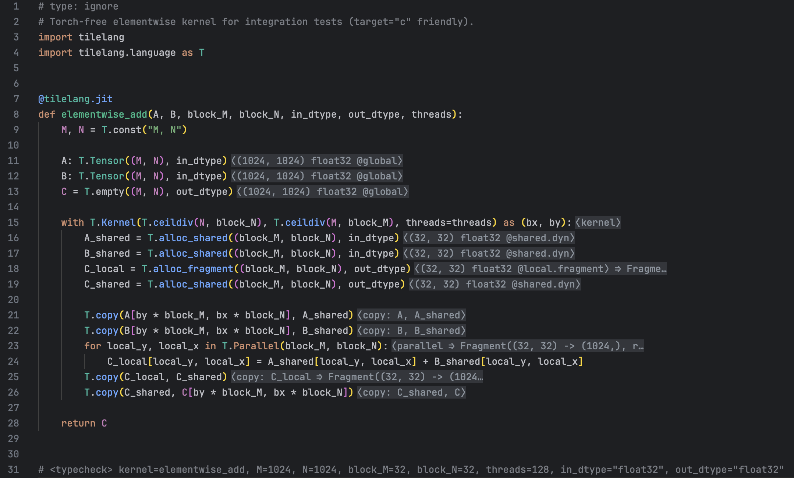
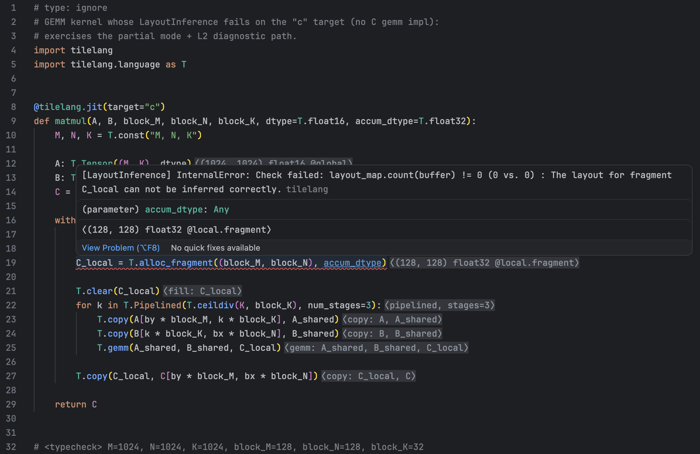

# TileLang LSP (tlsp)

[English README](./README.md)

为 [TileLang](https://github.com/tile-ai/tilelang) 实现的 Language Server Protocol (LSP) 服务，
提供 buffer shape/dtype/scope 与推断布局的 inlay hints、hover 详情和精确诊断。

## 功能

- **行尾 inlay hints**，共五类：
  - `alloc` —— `X = T.alloc_*(...)` 行：shape/dtype/scope；LayoutInference 跑过后附带推断出的 `Layout`/`Fragment`
  - `param` —— kernel 签名参数：`⟨(M, K) float16 @global⟩`
  - `op` —— `T.copy` / `T.gemm` 等行：涉及 buffer 布局的短摘要
  - `loop` —— `T.Pipelined` / `T.Parallel` 行：`⟨pipelined, stages=3⟩`、parallel loop layout
  - `kernel` —— `with T.Kernel(...)` 行：grid 维度与线程数
- **Hover**：在 hint 行上悬停查看完整 layout/fragment 文本。
- **诊断**：三级精度（见下文）。
- **kernel 编译不过也能用**：四级降级链尽可能给出 hints（见"工作原理"）。

结果缓存于内存（LRU）与磁盘 `~/.cache/tilelang_lsp/`（可用 `TLSP_CACHE_DIR` 覆盖），
key 为文件内容 hash + target + tilelang 版本。

## 安装

1. Python 3.8+，且能 import [tilelang](https://github.com/tile-ai/tilelang)
   （用于完整分析；没有 tilelang 时 tlsp 仍提供静态 hints）。
2. 安装 server 包：
   ```bash
   pip install -e .
   ```
3. 安装 VS Code 扩展（见下）。

## 使用

### VS Code

```bash
cd tilelang_lsp_extension
npm install
vsce package   # 生成 tilelang-type-decorator-*.vsix
```

在 VS Code 中安装生成的 `.vsix`。扩展会用配置的解释器启动 `python -m tlsp`。
开发/调试扩展：`npm run compile`，然后在 VS Code 打开 `src/extension.ts` 按 F5。

配置项（均在 `tilelang.*` 下，修改后 server 自动重启）：

| 配置项 | 默认值 | 含义 |
|---|---|---|
| `tilelang.pythonPath` | `"python"` | 运行 server 的 Python 解释器（须能 `import tlsp`；能 import tilelang 更佳） |
| `tilelang.enableInlayHints` | `true` | server 总开关 |
| `tilelang.serverArgs` | `[]` | 追加到 `python -m tlsp` 的额外 CLI 参数（如 `["--target", "c"]` 可改默认分析 target) |
| `tilelang.serverEnv` | `{"TILELANG_ENABLE_DATA_RACE_CHECK": "1"}` | 传给 server 进程的环境变量（analyzer 子进程继承）。默认开启数据竞争诊断；删除该键即关闭。注意自定义时整体替换默认对象——仍要 race 诊断需保留该键。`PYTHONPATH` 由扩展托管 |

### Neovim

```lua
vim.lsp.config['tlsp'] = {
  cmd = { 'python', '-m', 'tlsp' },  -- 无 CUDA 的机器加 '--target', 'c'
  filetypes = { 'python' },
  root_markers = { 'pyproject.toml', '.git' },
}
vim.lsp.config['tlsp'].capabilities = vim.lsp.protocol.make_client_capabilities()
vim.lsp.enable('tlsp')
```

在 VS Code 之外使用时，在 server 进程环境中设 `TILELANG_ENABLE_DATA_RACE_CHECK=1`
可开启数据竞争诊断（VS Code 扩展通过 `tilelang.serverEnv` 默认开启）。

### `<typecheck>` 指令

tlsp 需要具体的 kernel 实参才能展开 TIR。按以下优先级解析：

1. 离 kernel 定义最近的注释指令：
   ```python
   # <typecheck> M=1024, N=1024, K=1024, block_M=128, kernel=matmul
   ```
   值经 `ast.literal_eval` 解析；`"float16"` 之类的 dtype 字符串直接可用。
   `kernel=` 用于选择分析哪个 kernel（缺省取文件内第一个 `@tilelang.jit`）。
2. 从文件中 `<name>.compile(...)` / 对 kernel 的直接调用收割 kwargs。
3. 函数签名默认值。

分析 target 取自代码：`# <typecheck> target=c` 优先于
`<kernel>.compile(...)` 调用点的 `target=`，调用点又优先于
`@tilelang.jit(target=...)` 装饰器字面量，装饰器再优先于 server 默认值
（`--target`，未设置时为 `cuda`）。

缺少必需参数时会产生诊断，提示补 `<typecheck>` 指令。
`T.const("M, N")` 声明的符号变量可以不绑定（保持符号即可）。

### CLI 调试

```bash
python -m tlsp.analyzer --once path/to/kernel.py --target c
```
以单行 JSON 输出完整分析结果（schema v2）。

## 工作原理

每次打开/保存时，analyzer 按四级降级链执行并上报所处模式：

| 模式 | 条件 | 你能得到什么 |
|---|---|---|
| `full` | `get_tir` 成功 + 前端 pass 跑通至 LayoutInference | 全部 hints，alloc hint 带推断布局 |
| `partial` | `get_tir` 成功，某个 pass 失败 | 用最后一个成功的 IR 状态收集 hints + L2 精确诊断（从 pass 报错中的 `--> file:line:col` 标记解析出行号） |
| `tracer` | IR span 不可用（旧版 tilelang，或 `TILELANG_ENABLE_IR_SPAN=0`） | monkeypatch `T.*` 入口的调用 tracer 产出 hints；pass 成功时按 buffer 名 join 布局 |
| `static` | `get_tir` 失败（import 错误、NameError、写到一半的代码） | 纯 AST hints（shape/dtype/scope）+ shape mismatch 警告 + L1 诊断（traceback 重映射定位） |

若 analyzer 子进程本身崩溃或完全没有 tilelang，server 降级为静态模式并给出
文件级（L3）诊断说明原因。

编辑过程中（保存前）hints 来自同一套静态分析（进程内运行）——
因此对残缺代码也能保持响应与正确。

## 开发

```bash
python -m unittest discover tests -v    # 单元测试（无需 tilelang）
```

集成测试需要真实的 tilelang 环境，由环境变量门控（未设置时自动 skip）：

```bash
TLSP_TEST_PYTHON=/path/to/tilelang/venv/bin/python \
TLSP_TEST_TILELANG=/path/to/tilelang/repo \
python -m unittest tests.test_integration -v
```

## 演示



诊断信息


