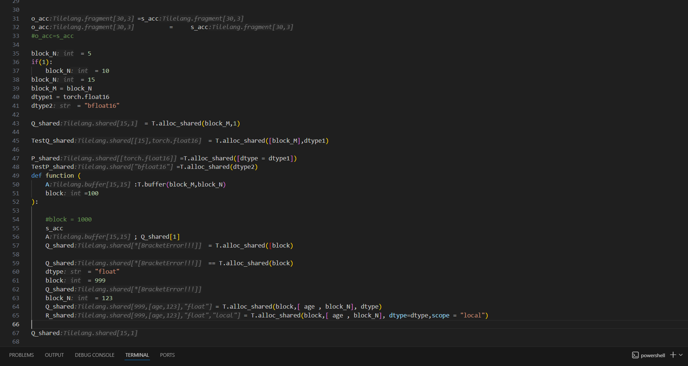

# tilelang_LSP_extension README


## Release Notes


### 0.0.1

Now, the extension supports interpreting variables defined with basic tilelang allocation languages such as T.alloc_shared(), T.alloc_fragment() and so on.
Basic variable lifetime analysis is supported.

---
## Requirements
The extension requires **npm** to compile the code and **vsce** to package and release.

## How to use the LSP VSCode extension

To package and release the extension, one can run the following bash code to compile the dependencies of releasing the extension:
```bash
cd tilelang_lsp_extension
npm install
```
Then under the folder /tilelang_lsp_extension/, run

```bash
vsce package
```
If there are some confirmations that show up in the console, please type in "yes".
Once the extension is packaged, an extension program "tilelang-type-decorator-(*version).vsix" will appear in the current folder, and you can install this extension with VSCode.


If you are a developer and you wish to debug the extension, you can run

```bash
cd tilelang_lsp_extension
npm run compile
```
and in VS Code, open src/extension.ts and press F5 to enter the debug mode.

## Working mechanism

The extension loops the .py document and captures allocation and function input expressions in tilelang (e.g. A_shared = T.alloc_shared()).
Once an expression that conforms the format of a pre-defined Regex, properties such as the dimension, dtype, and scope will be interpreted recursively based on the context.

## Example
An example python file ./test.py for testing the function of the extension is provided. 

## Following extension guidelines
1. Install the extension
2. Inlay decorations will be displayed on the screen

**Enjoy!**
